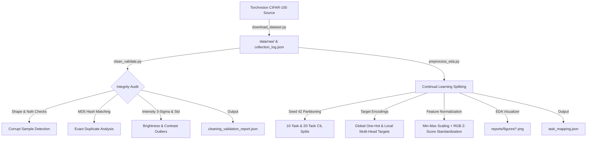

# CIFAR-100 Continual Learning Benchmark & Exploratory Data Analysis
### Research Deliverable 1: Data Acquisition, Quality Validation, Preprocessing & EDA Pipeline

[](https://www.python.org/)
[](https://pytorch.org/)
[](https://pytorch.org/vision/stable/index.html)
[](https://www.cs.toronto.edu/~kriz/cifar.html)
[](LICENSE)

---

## 📌 Executive Summary

This repository houses the complete, reproducible research pipeline for **Deliverable 1**, centered on preparing and auditing the **CIFAR-100** dataset for **Continual / Class-Incremental Learning (CIL)** benchmarks.

The codebase implements an end-to-end data pipeline covering:
1. **Automated Ingestion & Provenance Tracking**: Programmatic dataset collection with timestamped audit logging.
2. **Rigorous Quality Control & Data Validation**: Integrity verification, boundary checks, byte-level MD5 duplicate identification, and distribution outlier screening.
3. **Continual Learning Task Partitioning**: Generation of canonical multi-task benchmark configurations (10-task and 20-task class-incremental splits) with deterministic seed control.
4. **Target Encoding Schemes**: Encoding targets for both global single-head (100-dim one-hot) and incremental multi-head ($y_{\text{local}}$) neural architectures.
5. **Feature Preprocessing & Standardization**: Min-Max scaling followed by channel-wise Z-score normalization matching CIFAR-100 population statistics.
6. **Exploratory Data Analysis (EDA)**: Generation of four publication-ready figures characterizing sample distributions, image diversity, channel correlations, and feature transforms.

---

## 📂 Repository Structure

```
AI research deliverable 1/
│
├── .gitignore                      # Prevents committing large raw binaries/datasets to Git
├── requirements.txt                # Pinned third-party dependencies (PyTorch, Torchvision, NumPy, Matplotlib)
├── run_pipeline.py                 # Master orchestrator executing the end-to-end pipeline
│
├── data_scripts/                   # Modular data processing and analysis scripts
│   ├── download_dataset.py         # Step 1: Ingestion, verification, and provenance logging
│   ├── clean_validate.py           # Step 2: Quality assurance, duplicate check & anomaly screening
│   └── preprocess_eda.py           # Step 3: Task splitting, feature normalization, and EDA plotting
│
├── data/                           # Data storage directory (created on execution)
│   ├── raw/                        # Raw CIFAR-100 archives (excluded from Git via .gitignore)
│   │   ├── .gitkeep
│   │   ├── cifar-100-python.tar.gz
│   │   └── collection_log.json     # Provenance and ingestion metadata
│   │
│   └── processed/                  # Processed metadata and benchmark splits
│       ├── cleaning_validation_report.json # Comprehensive quality audit report
│       └── task_mapping.json       # Continual learning task splits and encoding metadata
│
└── reports/                        # Visual deliverables and figures
    └── figures/                    # Publication-quality EDA charts (200 DPI PNGs)
        ├── class_distribution.png  # Training sample frequencies across 100 classes
        ├── sample_images.png       # 4x5 visual grid of representative class samples
        ├── pixel_statistics.png    # Pre- vs. post-normalization intensity distributions
        └── channel_correlation.png # Inter-channel (RGB) Pearson correlation matrix
```

---

## 🔬 Dataset Overview & Provenance

The **CIFAR-100** (Canadian Institute for Advanced Research) dataset is a standard computer vision benchmark curated by Alex Krizhevsky (2009).

| Attribute | Specification |
| :--- | :--- |
| **Source Citation** | Krizhevsky, A. (2009). *Learning Multiple Layers of Features from Tiny Images*. University of Toronto. |
| **API Provider** | `torchvision.datasets.CIFAR100` |
| **Spatial Resolution** | $32 \times 32$ pixels, 3 color channels (RGB) |
| **Total Samples** | 60,000 images |
| **Training Partition** | 50,000 images (500 images per class) |
| **Test Partition** | 10,000 images (100 images per class) |
| **Class Taxonomy** | 100 fine-grained classes grouped into 20 coarse superclasses |
| **Class Balance** | Exactly uniform (500 samples/class train; 100 samples/class test) |

---

## ⚙️ Technical Architecture & Pipeline Stages



### Stage 1: Data Ingestion & Provenance Tracking (`download_dataset.py`)
- Automatically initializes the `data/raw/` directory structure.
- Fetches and verifies the official CIFAR-100 dataset archive through `torchvision.datasets.CIFAR100(..., download=True)`.
- Generates `data/raw/collection_log.json` containing:
  - Dataset source citation and official download timestamp.
  - Partition lengths (50,000 train / 10,000 test).
  - Class dimensionality and raw tensor shapes ($[32, 32, 3]$).

### Stage 2: Quality Assurance & Data Validation (`clean_validate.py`)
Applies data hygiene checks over all 60,000 training and test instances:
- **Structural Integrity**: Checks for missing instances (`None`), dimension mismatches ($\neq 32 \times 32 \times 3$), and corrupt non-numerical entries (`NaN` / `Inf`).
- **Label Validity**: Asserts all label targets fall strictly within the valid range $[0, 99]$.
- **Byte-Level De-Duplication**: Converts each image to an immutable contiguous byte array and computes its MD5 cryptographic hash ($32$-character hex string). Any matching hashes are flagged and logged as duplicate index pairs.
- **Statistical Anomaly Detection**:
  - Image Mean Intensity: Calculates $\mu$ per sample; instances exceeding $3\sigma$ from the dataset mean ($|z| > 3.0$) are flagged as brightness anomalies.
  - Contrast Dispersion: Images with standard deviation $\sigma < 5.0$ are flagged as low-contrast outliers.
- Outputs an audit summary to `data/processed/cleaning_validation_report.json`.

### Stage 3: Continual Learning Task Splitting (`preprocess_eda.py`)
In Continual/Lifelong Learning, a model learns a sequence of disjoint tasks without catastrophic forgetting:
- **Seed Control**: Splits are initialized with a fixed seed (`SEED = 42`) for full scientific reproducibility.
- **10-Task Split (10 Classes/Task)**: Divides the 100 classes into 10 disjoint incremental tasks.
- **20-Task Split (5 Classes/Task)**: Divides the 100 classes into 20 fine-grained incremental tasks.
- **Dual Target Encodings**:
  - **Global Fine Index**: Standard class integer $y \in [0, 99]$.
  - **Multi-Head Local Target**: $y_{\text{local}} = \text{rank} \pmod{\text{classes\_per\_task}}$, mapping classes to task-specific local output heads $[0, K-1]$.
  - **Single-Head One-Hot Vector**: 100-dimensional sparse representation $\mathbf{y} \in \{0, 1\}^{100}$ generated via `torch.nn.functional.one_hot`.
- Persists all split definitions and encoding demonstrations to `data/processed/task_mapping.json`.

### Stage 4: Feature Scaling & Standardization (`preprocess_eda.py`)
Transforms raw `uint8` pixel values $[0, 255]$ into zero-mean, unit-variance standardized tensors:
1. **Min-Max Scaling**: `torchvision.transforms.ToTensor()` converts input images to `torch.float32` tensors scaled to $[0.0, 1.0]$.
2. **Channel-wise Z-score Standardization**: `torchvision.transforms.Normalize(mean, std)` applies:
   $$x'_c = \frac{x_c - \mu_c}{\sigma_c}$$
   using standard CIFAR-100 empirical channel population parameters:
   - $\mu_{\text{RGB}} = (0.5071, 0.4867, 0.4408)$
   - $\sigma_{\text{RGB}} = (0.2675, 0.2565, 0.2761)$

### Stage 5: Exploratory Data Analysis (EDA) Figures (`preprocess_eda.py`)
Saves four publication-grade visual artifacts in `reports/figures/` (200 DPI):
1. **`class_distribution.png`**: Frequency bar chart validating the uniform balance of 500 samples per class across all 100 classes.
2. **`sample_images.png`**: A $4 \times 5$ image montage showcasing 20 distinct fine classes with labels and IDs.
3. **`pixel_statistics.png`**: Dual density histograms comparing the distribution of scaled intensities $[0, 1]$ against the normalized zero-mean distributions for R, G, and B channels.
4. **`channel_correlation.png`**: Pearson correlation heatmap quantifying collinearity between the Red, Green, and Blue channels.

---

## 🚀 Installation & Environment Setup

### Prerequisites
- Python 3.9 or higher (tested on Python 3.9, 3.10, 3.11, 3.12, 3.13)
- Windows, macOS, or Linux

### 1. Clone or Open Workspace
```bash
cd "AI research deliverable 1"
```

### 2. Create and Activate a Virtual Environment
- **Windows (PowerShell)**:
  ```powershell
  python -m venv .venv
  .venv\Scripts\Activate.ps1
  ```
- **Linux / macOS (Bash)**:
  ```bash
  python3 -m venv .venv
  source .venv/bin/activate
  ```

### 3. Install Required Dependencies
```bash
pip install -r requirements.txt
```

---

## 💻 Execution Guide

### Option 1: Run the Complete Pipeline (Recommended)
Execute the master orchestrator script to run all stages in sequence:
```bash
python run_pipeline.py
```
This executes:
1. `download_dataset.py` (Downloads raw CIFAR-100 and creates `data/raw/collection_log.json`)
2. `clean_validate.py` (Performs data audit and creates `data/processed/cleaning_validation_report.json`)
3. `preprocess_eda.py` (Generates task splits in `data/processed/task_mapping.json` and 4 figures in `reports/figures/`)

### Option 2: Run Individual Stages
If you prefer running individual modules sequentially:

```bash
# Step 1: Download raw data and write provenance log
python data_scripts/download_dataset.py

# Step 2: Validate dataset integrity and detect duplicates
python data_scripts/clean_validate.py

# Step 3: Preprocess features, generate task splits, and plot EDA figures
python data_scripts/preprocess_eda.py
```

---

## 📊 Summary of Generated Deliverables

| Artifact Path | Format | Description |
| :--- | :--- | :--- |
| `data/raw/collection_log.json` | JSON | Dataset provenance metadata, download timestamp, and split sizes. |
| `data/processed/cleaning_validation_report.json` | JSON | Data quality audit: corrupt sample counts, duplicate pairs, and outlier analysis. |
| `data/processed/task_mapping.json` | JSON | Continual learning class-to-task mappings (10-task and 20-task) & target encodings. |
| `reports/figures/class_distribution.png` | PNG (200 DPI) | Class frequency distribution verifying uniform 500 samples/class balance. |
| `reports/figures/sample_images.png` | PNG (200 DPI) | Visual inspection grid of 20 representative CIFAR-100 classes. |
| `reports/figures/pixel_statistics.png` | PNG (200 DPI) | Empirical distributions before vs. after Z-score feature normalization. |
| `reports/figures/channel_correlation.png` | PNG (200 DPI) | Inter-channel RGB Pearson correlation matrix. |

---

## 🛡️ Reproducibility & Version Control Notes

- **Seed Determinism**: All random permutations and task partitions are fixed with seed `SEED = 42`.
- **Git Exclusions**: The provided `.gitignore` prevents large raw dataset archives (`*.tar.gz`, `data/raw/*`) from being committed to GitHub, while keeping folder structures tracked via `.gitkeep`.
- **System Portability**: Paths are constructed using Python's `pathlib.Path`, ensuring cross-platform execution on Windows, macOS, and Linux without modification.

---

## 📚 References & Citations

1. **CIFAR-100 Dataset**:
   ```bibtex
   @article{krizhevsky2009learning,
     title={Learning multiple layers of features from tiny images},
     author={Krizhevsky, Alex and Hinton, Geoffrey and others},
     year={2009},
     publisher={Toronto, ON, Canada}
   }
   ```
2. **Torchvision**:
   ```bibtex
   @software{torchvision2016,
     title={Torchvision: PyTorch's Computer Vision Library},
     author={Torchvision maintainers and contributors},
     year={2016},
     url={https://github.com/pytorch/vision}
   }
   ```
3. **Class-Incremental Continual Learning Benchmark Setup**:
   ```bibtex
   @inproceedings{rebuffi2017icarl,
     title={iCaRL: Incremental classifier and representation learning},
     author={Rebuffi, Sylvestre-Alvise and Kolesnikov, Alexander and Sperl, Georg and Lampert, Christoph H},
     booktitle={Proceedings of the IEEE conference on Computer Vision and Pattern Recognition (CVPR)},
     pages={2001--2010},
     year={2017}
   }
   ```
